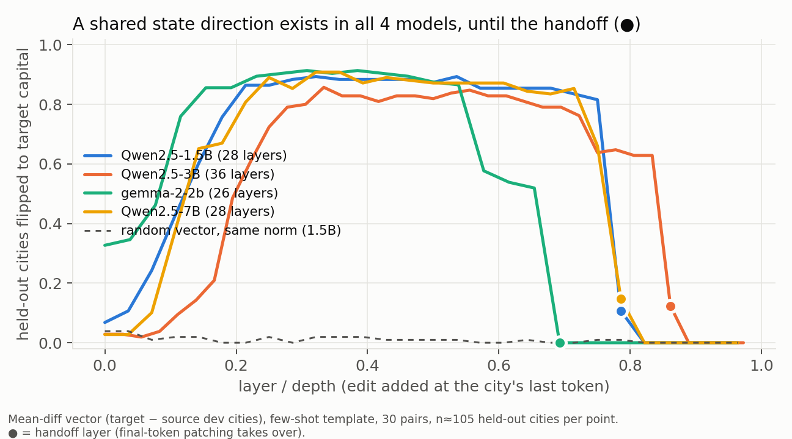

# EditHunt: where does a model keep the middle step of a two-hop fact?

Ask a language model *"The state containing Dallas has its capital in"* and it answers *" Austin"*. To get there it
has to make two hops: Dallas → Texas, then Texas → Austin. Does the model actually compute "Texas" somewhere inside,
and if so, can you find it and edit only that? And can an AI agent do this kind of investigation by itself?

**Short answer:** yes, the middle step is real. The same "state" direction appears at the city's token in four
models and stops working at a fixed "handoff" layer. Editing it is easy. Editing it *cleanly*, without spilling over
to other cities and without changing what the model believes about the state, is hard, and that is the part worth
building agent tasks around.

Models: Qwen2.5-1.5B, 3B and 7B, and gemma-2-2b. Agents: Claude Sonnet 5.5 and gpt-6.1-sol. September–October 2026.

**Write-up:** [dianhaoli.github.io/edithunt](https://dianhaoli.github.io/edithunt/) · **Full results:** [FINDINGS.md](FINDINGS.md) · Project report: [PROJECT_REPORT.md](PROJECT_REPORT.md) · Lab notebook: [LAB_NOTEBOOK.md](LAB_NOTEBOOK.md)

---

## 1. The state direction exists, until the handoff

Take the average activation at the city's last token for California cities, subtract the average for Texas cities,
and add that difference to a Texas city the vector has never seen. Over a wide band of middle layers, the model now
answers *" Sacramento"*. A random vector of the same size almost never does anything (≤ 0.05).

<p align="center"></p>

<p align="center"><sub><b>Figure 1.</b> Share of held-out cities flipped to the target capital, by layer (as a fraction
of depth). The dot marks the handoff: past it, editing the city token does nothing, because the information has
already moved to the final token.</sub></p>

| model | band (flip ≥ 0.5) | peak flip | handoff |
|---|---|---|---|
| Qwen2.5-1.5B | L5–21 | 0.89 | L22 |
| Qwen2.5-3B | L8–30 | 0.86 | L31 |
| gemma-2-2b | L3–17 | 0.91 | L18 |
| Qwen2.5-7B | L4–21 | 0.91 | L22 |

## 2. It means "this city is in California", not "say Sacramento"

The same vector also changes the answer to a different question, *"Which US state is X in?"*, as often as it changes
the capital (0.95–0.98). Generic text is untouched. The one real side effect is **leakage**: cities from *other*
states also start answering Sacramento (13–34%, depending on the model).

## 3. Leakage is what separates good edits from bad ones

| method | flip (unseen wording) | leakage |
|---|---|---|
| copy the whole activation from a California city | 0.66–0.76 | 0.94–1.00 |
| difference of means | 0.66–0.72 | 0.14–0.24 |
| gradient: "make it say the target capital" | 0.97–1.00 | 1.00 |
| gradient, with a penalty for changing 4 other states | **0.83–0.97** | **0.07–0.12** |

Anything trained only to "output Sacramento" learns exactly that and fires on every city. Only a method that
explicitly guards against leakage is both effective and specific.

A harder version: change the capital **while the model still says the city is in Texas**. A size-capped edit trained
for both reaches 0.98 at layer 8. Difference of means never manages it (≤ 0.02).

## 4. Turning it into agent tasks

Each task gives an agent tools to read and edit the subject model and scores the result with a programmatic grader,
on cities and wordings the agent never sees.

- **Easy tasks are solved by the obvious recipe.** Claude Sonnet 5.5 passes "flip the capital" 8/8, using difference
  of means in 4–6 turns.
- **"Keep the state" is hard.** Sonnet passes 1/7. Every naive script passes 0/7.
- **Undo a planted edit (T8).** Someone has secretly edited the model. The agent gets only the edited model, not the
  original, and has to restore it. Patching the visible answers back recovers 0–0.43 of the damage; finding and
  inverting the mechanism recovers 0.83–0.99. gpt-6.1-sol passes 4/16 runs without any method hint. It finds the
  layer by comparing affected and control cities, but it never undoes both edits in a two-edit instance.

Everything that solves these tasks is a real interpretability procedure, and which one works depends on the
instance. That is the property an environment for training agents needs.

## Caveats

- Per-instance scores are coarse (3–6 held-out items each), and agent runs are small (n = 2–8 per cell).
- The method ladder and the second-hop result were only run on Qwen2.5-1.5B.
- Some T8 failures came from a hidden cost cap, not from the agent. The audit in FINDINGS §12.5 separates the two.

## Repository

| path | what it is |
|---|---|
| `edithunt/` | hooks, vector methods, metrics, model loading |
| `edithunt/env/` | agent tools, tasks, graders, instance generator ([README_ENV.md](edithunt/env/README_ENV.md)) |
| `experiments/` | one script per phase (`phase0_validity.py` … `phase4b_careful.py`, task suite, audits) |
| `results/` | figures, instances, run records |
| `analysis/t8_transcripts/` | what agents did on T8, success and failure reports |
| `tests/` | unit tests (`pytest tests/`) |
| `FINDINGS.md`, `PROJECT_REPORT.md` | full results and one-document project summary |
| `LAB_NOTEBOOK*.md` | append-only lab notebooks |
| `BRIEF.md` | the original research brief |
| `AUDIT*.md` | independent audits of the tools and graders |

## Setup

```bash
python -m venv .venv && .venv/bin/pip install -r requirements.txt
```

Agent runs need `ANTHROPIC_API_KEY` / `OPENAI_API_KEY` in a `.env` file (gitignored).
